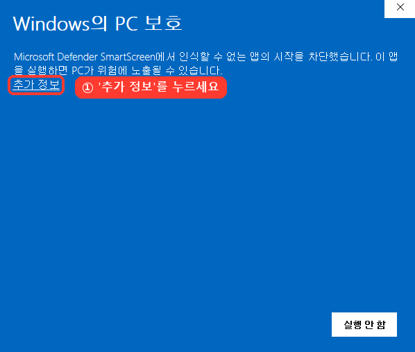
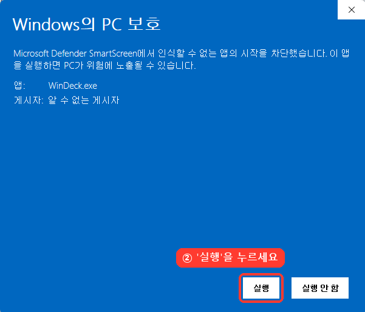

# 변경 기록

## 1.7.0 — 2026-11-21

> [!WARNING]
> **Microsoft Edge로는 설치되지 않습니다.** Chrome, 네이버 웨일, Firefox 등 다른 브라우저로 내려받으세요.

### 받을 파일
- **WinDeck-1.7.0.zip** — 새로 받는 분은 이것만 받으세요. 압축을 풀면 `WinDeck 설치.exe`, `WinDeck 제거.exe`, `app` 폴더가 있습니다. `WinDeck 설치.exe` 를 실행합니다.
- **WinDeck-Setup-1.7.0.exe**, **WinDeck-Portable-1.7.0.zip**, **WinDeck-SHA256-1.7.0.txt** — 자동 업데이트가 쓰는 파일 (직접 받을 필요 없음)

1.3.0 ~ 1.6.0 을 쓰는 분은 트레이 알림의 [지금 업데이트] 로 바로 바뀝니다.

처음 실행 시 "Windows의 PC 보호" 창이 뜨면 **[추가 정보] → [실행]**.

| ① **추가 정보** 누르기 | ② 앱 이름 확인 후 **실행** 누르기 |
|---|---|
|  |  |

### 추가
- **버튼 이름에서 줄 바꾸기**: 버튼 편집 창의 이름 칸이 3줄이 됨. Enter 를 누른 자리에서 버튼의 이름도 줄이 바뀜 (최대 3줄)
  - 전에는 띄어쓰기를 넣어 가며 줄이 넘어가는 자리를 맞춰야 했음
  - 직접 나누지 않은 긴 이름은 지금처럼 띄어쓰기에서 자동으로 나눔 (두 줄까지)
  - 이름 칸에서는 Enter = 줄바꿈. 저장은 [확인] 버튼 (경로·주소 칸의 Enter 는 [확인] 그대로)
  - 안내 문구·설명 풍선·단축키 목록에는 이름을 한 줄로 보여 줌
- **버튼 글자 크기**: 아주 작게 · 작게 · 보통 · 크게 · 아주 크게
  - 설정 → 일반 → [버튼 글자 크기]: 모든 버튼의 기본값
  - 버튼 편집 창 → [글자 크기]: 그 버튼만 따로. [기본값]을 고르면 설정을 따름
  - 미리보기에 바로 보임
  - 글자가 크거나 줄이 많아 자리가 모자라면 아이콘을 줄여 자리를 만듦 (아이콘은 버튼의 20% 까지)
  - 그래도 모자라면 줄 수를 줄이고 끝을 "…" 로 표시

아래 "고침"은 1.6.0 까지의 코드를 처음부터 다시 검토해서 찾은 문제입니다.

### 고침 — 업데이트·설치·제거
- **업데이트 뒤 WinDeck 이 사라지던 문제**: WinDeck 버튼으로 연 프로그램(브라우저, 명령 창 등)이 켜져 있으면, 업데이트가 `app` 폴더의 파일만 지우고 멈췄음
  - 이제 새 파일을 먼저 따로 복사한 뒤 하나씩 바꿈. 복사하지 못하면 쓰던 버전을 그대로 둠
  - 버튼으로 연 프로그램은 사용자 폴더에서 시작함. WinDeck 설치 폴더를 붙잡지 않음
- 자동 업데이트가 실패하면 쓰던 WinDeck 을 다시 켜고 트레이 알림으로 알림 (전에는 알림 없이 꺼진 채로 남았음)
- 제거는 설치가 만든 파일만 지움
  - 설치 폴더에 직접 넣어 둔 파일은 남김
  - 설치 폴더 안의 폴더 연결(접합점)은 연결만 지움. 연결이 가리키는 곳의 파일은 건드리지 않음
  - 파일을 지우지 못하면 '설치된 앱' 등록을 지우기 전에 멈춤. 다시 제거할 수 있음
- 압축을 푼 폴더의 `app\WinDeck.exe` 를 바로 켜도, 설치한 WinDeck 의 자동 실행이 그 파일로 바뀌지 않음
- 1.3 이하를 다른 폴더에 설치해 쓰던 경우, 그 '설치된 앱' 항목을 지우지 않음 (옛 설치를 제거할 수 있게)
- 압축을 설치 폴더에 풀고 그 안의 `WinDeck 설치.exe` 를 실행해도 파일이 지워지지 않음
- 업데이트 파일은 https 주소에서만 받음. 릴리스 정보의 파일 이름도 검사함

### 고침 — 패널
- **버튼 위에서 마우스 휠 한 칸에 페이지가 두 번 넘어가던 문제** (페이지가 2개면 넘어가지 않는 것처럼 보였음)
- 버튼을 끄는 중 오른쪽·가운데 버튼을 누르면 끌기를 취소함 (전에는 그 자리에 놓였음). 메뉴도 열리지 않음
- [비우기]·[붙여넣기]·끌어 놓기의 확인 창이 떠 있는 사이 단축키로 페이지를 넘기면, 다른 페이지의 버튼이 바뀌던 문제
- 패널을 끄는 중 다른 창이 뜨면 패널이 마우스를 계속 따라오던 문제
- 모니터를 뽑거나 해상도를 바꿔 패널이 화면 밖에 남으면 화면 안으로 옮김 (일부러 가장자리에 걸쳐 둔 패널은 그대로)
- 좁은 세로 배치(8칸, 작은 버튼)에서 페이지 이름이 "…" 로만 보이면 페이지 번호를 보여 줌. 패널 설명 풍선에도 페이지 번호가 나옴
- 위쪽 막대 버튼 위에 '옮기기' 커서(네 방향 화살표)가 남던 문제
- 없는 파일이나 끊긴 네트워크 드라이브의 프로그램 버튼이 있으면 패널이 그릴 때마다 디스크를 확인하던 문제 (찾은 결과를 기억함)
- 패널을 움직이지 않고 클릭만 해도 설정 파일을 다시 쓰던 문제

### 고침 — 버튼 동작·입력
- `Win+L` (화면 잠금) 단축키 버튼: 키 입력 대신 Windows 의 잠금 기능을 직접 부름 (Windows 는 프로그램이 보낸 `Win+L` 로는 잠그지 않음)
- 숫자판 `+` 키를 [단축키 바꾸기]로 받아 적으면 저장할 수 없던 문제 (`NumPlus` 로 적음)
- 한글 입력 상태에서 [단축키 바꾸기]로 글자 키를 받으면 `ProcessKey` 로 적히던 문제 (받는 동안 한글 입력을 끔)
- 붙여넣기 방식 입력이 실패하면 복사해 둔 내용이 돌아오지 않던 문제
- 관리자 권한 창이 앞에 있을 때 페이지 넘기기 단축키가 오류 창을 띄우던 문제
- 실행 옵션의 `%USERPROFILE%` 같은 환경 변수를 실제 값으로 바꿈 (파일 경로와 같게)
- 파일 고르기 창에서 연 폴더를 WinDeck 이 계속 붙잡지 않음

### 고침 — 이미지·사이트 아이콘
- 휴대폰으로 세로로 찍은 사진이 배경·버튼 이미지에서 옆으로 눕던 문제
- 사이트 아이콘
  - `example.com` 과 `www.example.com` 을 같은 사이트로 봄 (페이지가 알려 주는 큰 아이콘을 먼저 받음)
  - 접속을 막은 주소(403·404) 뒤에 다음 주소를 8초씩 기다리던 문제
  - 전체 시간 제한(20초)을 내용을 받는 동안에도 지킴
  - 가로·세로가 4096픽셀을 넘는 그림은 받지 않음
  - 바깥 사이트가 이 PC 나 사내망 주소로 연결하면 받지 않음

### 바뀜
- 작은 버튼에서 두 줄이 필요한 이름이 한 줄 + "…" 로 잘리던 것이 두 줄로 보임 (여백을 줄여 자리를 만듦)
- 글자 크기 [보통]에서 두 줄 안에 들어가는 이름은 전과 같은 자리에 그림
- 버튼 편집 창: 경로·주소·실행 옵션 칸에서 Enter = [확인] (이름 칸은 Enter = 줄바꿈). Tab 은 화면에 보이는 순서로 이동. 화면이 작으면 창을 줄이고 스크롤함
- 단축키 지정 창, 아이콘 모음 창: Enter = [확인]
- 설정 → 배경: 어둡기 막대를 끌 때 미리보기가 이미지를 매번 다시 풀지 않음
- 오류 기록(`error.log`)은 1MB 를 넘으면 `error.old.log` 로 넘기고 새로 씀

## 1.6.0 — 2026-11-20

> [!WARNING]
> **Microsoft Edge로는 설치되지 않습니다.** Chrome, 네이버 웨일, Firefox 등 다른 브라우저로 내려받으세요.

### 받을 파일
- **WinDeck-1.6.0.zip** — 새로 받는 분은 이것만 받으세요. 압축을 풀면 `WinDeck 설치.exe`, `WinDeck 제거.exe`, `app` 폴더가 있습니다. `WinDeck 설치.exe` 를 실행합니다.
- **WinDeck-Setup-1.6.0.exe**, **WinDeck-Portable-1.6.0.zip**, **WinDeck-SHA256-1.6.0.txt** — 자동 업데이트가 쓰는 파일 (직접 받을 필요 없음)

1.3.0·1.4.0·1.5.0 을 쓰는 분은 트레이 알림의 [지금 업데이트] 로 바로 바뀝니다.

처음 실행 시 "Windows의 PC 보호" 창이 뜨면 **[추가 정보] → [실행]**.

| ① **추가 정보** 누르기 | ② 앱 이름 확인 후 **실행** 누르기 |
|---|---|
|  |  |

### 추가
- **끌어서 다른 페이지로 옮기기** (스마트폰 앱 정리처럼): 버튼을 끈 채로 패널 왼쪽·오른쪽 가장자리에 잠시(0.6초) 머물면 이전·다음 페이지로 넘어감
  - 패널 안쪽 여백부터 패널 밖 조금(약 60픽셀)까지가 가장자리. 위쪽 막대의 ◀ ▶ 위에 머물러도 넘어감
  - 머무는 쪽 여백에 파란 막대가 차오르고, 다 차면 넘어감. 계속 머물면 1초마다 한 페이지씩 더 넘어감
  - 마지막 페이지 다음은 첫 페이지 (◀ ▶·마우스 휠과 같음)
  - 넘어간 페이지의 칸에 놓으면 버튼이 그 칸으로 감. 버튼이 있는 칸이면 두 버튼이 자리를 바꿈 (그 버튼은 원래 페이지의 빈자리로)
  - 버튼의 바로 실행 단축키도 함께 옮겨 감
  - 패널 밖에 놓거나 끌기가 취소되면 아무것도 바뀌지 않고, 패널은 버튼이 있던 페이지로 돌아감
  - 끄는 중 마우스 휠로 페이지를 넘겨도 넘어간 페이지에 놓임

### 고침
- 끄는 중 마우스 휠로 페이지를 넘긴 뒤 놓으면, 보이는 페이지가 아니라 원래 페이지의 칸끼리 자리를 바꾸던 문제

## 1.5.0 — 2026-11-20

> [!WARNING]
> **Microsoft Edge로는 설치되지 않습니다.** Chrome, 네이버 웨일, Firefox 등 다른 브라우저로 내려받으세요.

### 받을 파일
- **WinDeck-1.5.0.zip** — 새로 받는 분은 이것만 받으세요. 압축을 풀면 `WinDeck 설치.exe`, `WinDeck 제거.exe`, `app` 폴더가 있습니다. `WinDeck 설치.exe` 를 실행합니다.
- **WinDeck-Setup-1.5.0.exe**, **WinDeck-Portable-1.5.0.zip**, **WinDeck-SHA256-1.5.0.txt** — 자동 업데이트가 쓰는 파일 (직접 받을 필요 없음)

1.3.0·1.4.0 을 쓰는 분은 트레이 알림의 [지금 업데이트] 로 바로 바뀝니다.

처음 실행 시 "Windows의 PC 보호" 창이 뜨면 **[추가 정보] → [실행]**.

| ① **추가 정보** 누르기 | ② 앱 이름 확인 후 **실행** 누르기 |
|---|---|
|  |  |

### 추가
- **링크 버튼에 사이트 아이콘 자동 넣기**: 링크를 패널에 끌어 놓으면 그 사이트의 아이콘을 받아 버튼에 넣음 (예: chatgpt.com → ChatGPT 아이콘)
  - 버튼을 먼저 만들고, 아이콘은 받는 대로 넣음. 그동안 패널은 멈추지 않음
  - 아이콘은 그 사이트에서만 받음. 다른 회사의 아이콘 서비스로 주소를 보내지 않음
  - 못 받으면 (막힌 사이트, 사내 사이트, SVG 아이콘만 있는 사이트) 지금처럼 기본 모양
  - 로그인이 필요한 사이트는 로그인 화면의 아이콘이 들어갈 수 있음. 그때는 [아이콘 모음]·[내 이미지]로 바꾸기
  - 어두운 아이콘이 투명 바탕이면 흰 바탕을 깔아 어두운 버튼에서도 보이게 함
  - 받은 아이콘은 설정 파일에 저장 (아이콘 하나에 평균 약 6KB). 한 번 받으면 인터넷 없이도 보임
  - 이름 창에서 [취소]하거나, 받는 사이에 아이콘을 직접 고르면 받은 아이콘은 버림
- **버튼 편집 창 [사이트 아이콘 넣기]**: 링크 버튼에서 누르면 그 주소의 사이트 아이콘을 넣음
- **설정 → 페이지 → [사이트 아이콘…]**: 아이콘이 없는 링크 버튼(모든 페이지)에 사이트 아이콘을 한꺼번에 넣음
  - 직접 고른 아이콘은 바꾸지 않음. 같은 사이트는 한 번만 받음
  - 못 받은 버튼은 이유와 함께 보여 줌. 설정 창의 [확인]을 눌러야 저장

## 1.4.0 — 2026-11-19

> [!WARNING]
> **Microsoft Edge로는 설치되지 않습니다.** Chrome, 네이버 웨일, Firefox 등 다른 브라우저로 내려받으세요.

### 받을 파일
- **WinDeck-1.4.0.zip** — 새로 받는 분은 이것만 받으세요. 압축을 풀면 `WinDeck 설치.exe`, `WinDeck 제거.exe`, `app` 폴더가 있습니다. `WinDeck 설치.exe` 를 실행합니다.
- **WinDeck-Setup-1.4.0.exe**, **WinDeck-Portable-1.4.0.zip**, **WinDeck-SHA256-1.4.0.txt** — 1.3.0 의 자동 업데이트가 쓰는 파일 (직접 받을 필요 없음)

1.3.0 을 쓰는 분은 트레이 알림의 [지금 업데이트] 로 바로 바뀝니다.

처음 실행 시 "Windows의 PC 보호" 창이 뜨면 **[추가 정보] → [실행]**.

| ① **추가 정보** 누르기 | ② 앱 이름 확인 후 **실행** 누르기 |
|---|---|
|  |  |

### 추가
- **버튼 끌어 옮기기**: 버튼을 누른 채 끌어 같은 페이지의 다른 칸에 놓기. 다른 버튼 위에 놓으면 두 버튼이 자리를 바꿈
  - 끄는 동안 버튼 모양이 마우스를 따라오고, 놓을 칸에 파란 테두리
  - 조금 움직인 클릭은 그대로 클릭으로 실행. 패널 밖에 놓으면 그대로
- **다른 페이지로 옮기기**: 버튼 우클릭 → [다른 페이지로 옮기기] → 페이지 선택. 그 페이지의 첫 빈칸으로 옮기고 패널은 지금 페이지에 남음
  - 빈칸이 없는 페이지는 "(빈칸 없음)" 으로 표시, [새 페이지를 만들어 옮기기…]
  - 버튼의 바로 실행 단축키도 함께 옮겨 감
- **끌어 놓을 때 버튼 이름 묻기**: 파일·폴더·링크를 패널에 끌어 놓으면 이름 입력 창이 뜸 (자동 이름이 미리 들어 있어 Enter 로 그대로 만들기, [취소]면 만들지 않음)
  - 브라우저 주소 창의 자물쇠를 끌어 놓으면 페이지 제목을 자동 이름으로 씀

### 바뀜 — 설치 방식과 폴더 구조
- **받는 꾸러미**: 맨 위에 `WinDeck 설치.exe`, `WinDeck 제거.exe` 두 개만 있고, 구동 파일은 `app` 폴더에 모음
- **설치 프로그램을 새로 만듦** (Inno Setup 대신): 관리자 권한 없이 `%LOCALAPPDATA%\Programs\WinDeck` 에 설치, Windows '설치된 앱' 에 등록
  - 다시 설치·업데이트할 때 바탕 화면 바로가기·자동 실행 선택을 그대로 유지
  - 1.3.0 이하 설치본 위에 설치하면 옛 파일·시작 메뉴 폴더·등록 정보를 정리
- **제거는 설치가 만든 것만 지움**: 설치 표식 파일과 정해진 설치 경로가 모두 맞을 때만 폴더를 지움. 바로가기·자동 실행 값은 설치 폴더를 가리킬 때만 지움. 버튼 설정은 지울지 물음
- **포터블판 없음**: 설정은 늘 `%APPDATA%\WinDeck`. 1.3 이하 포터블판의 `WinDeckData` 설정이 더 최근이면 처음 실행할 때 자동으로 옮김 (옮기기 전 설정은 백업, 옛 폴더는 그대로 둠). 설치하지 않은 WinDeck 은 트레이 메뉴 [설치하기…] 로 설치
- 자동 업데이트는 늘 설치 파일로 설치 (설치하지 않고 쓰던 WinDeck 도 설치판으로 바뀜)
- 저장소 폴더 정리: 소스·점검·문서·빌드 도구는 `src` 아래로
- **사용 조건 바뀜**: MIT 대신 모든 권리 보유(2J시스템, musiqsb-svg). 비상업적 무료 사용만 허락, 허락 없는 코드 복사·수정·재배포·기능 복제·AI 복제 금지 (`LICENSE`, `NOTICE`). 1.3.0 이하는 MIT 그대로
  - 저작권 안내를 모든 소스 파일 머리말, `NOTICE`, README, 프로그램 파일 속성과 파일 안에 넣음

## 1.3.0 — 2026-10-27

> [!NOTE]
> 이 판의 파일은 2026-11-19부터 받을 수 없습니다. 최신 판을 받으십시오: https://github.com/musiqsb-svg/WinDeck/releases/latest

> [!WARNING]
> **Microsoft Edge로는 설치되지 않습니다.** Chrome, 네이버 웨일, Firefox 등 다른 브라우저로 내려받으세요.

### 받을 파일
- **WinDeck-Setup-1.3.0.exe** — 설치판 (권장). 덮어 설치하면 버튼 설정 유지 (실행 중이면 설정을 저장하게 한 뒤 닫고 설치)
- **WinDeck-Portable-1.3.0.zip** — 포터블판. 새 폴더에 풀어도 처음 실행할 때 이전 포터블 설정을 찾아 불러올지 물어봄
- **WinDeck-SHA256-1.3.0.txt** — 자동 업데이트용 검사 목록 (직접 받을 필요 없음)

1.2.0 이하에서는 이번 한 번만 직접 받아 설치하세요. 1.3.0 부터는 새 버전이 나오면 트레이 알림을 눌러 바로 설치합니다.

처음 실행 시 "Windows의 PC 보호" 창이 뜨면 **[추가 정보] → [실행]**.

| ① **추가 정보** 누르기 | ② 앱 이름 확인 후 **실행** 누르기 |
|---|---|
|  |  |

### 고침 — 업데이트 뒤 최근 설정이 되돌아가던 문제
- 포터블판을 새 폴더에 풀면 빈 `WinDeckData` 로 새로 시작하던 문제 → 처음 실행할 때 이전에 쓰던 설정(예전 포터블 폴더, 설치판 설정, 마지막으로 쓴 위치)을 찾아 불러올지 물어봄
- 실행 중에 설정 파일이 바뀌어도(백업 파일로 교체, 다른 PC에서 복사 등) 메모리에 있던 예전 설정으로 덮어쓰던 문제 → 바뀐 파일을 감지해 다시 읽고, 그래도 덮어쓰게 되면 그 파일을 먼저 백업
- 설치·빌드 때 WinDeck 을 강제 종료하던 방식 → 종료 신호를 보내 설정을 저장한 뒤 스스로 닫히게 함 (5초 안에 닫히지 않을 때만 강제 종료)
- 설정 창을 열어 둔 사이 단축키로 넘긴 페이지가 [확인] 뒤 이전 페이지로 돌아가던 문제

### 추가
- **새 버전 알림 + 한 번 눌러 설치**: 하루 한 번 확인 → 트레이 알림 → [지금 업데이트] 로 받기·SHA-256 검사·설치·다시 실행까지 자동
  - 설치판은 설치 파일을 조용히 실행, 포터블판은 `WinDeck.exe` 만 교체 (`WinDeckData` 그대로)
  - [나중에] / [이 버전 건너뛰기], 설정 > 일반 에서 자동 확인 끄기·지금 확인, 트레이 메뉴 "업데이트 확인…"
- **자동 백업 (최근 20개)**: 하루 한 번, 설정 바꾸기·불러오기·되돌리기 직전, 업데이트 직전, 바뀐 설정 파일을 다시 읽기 직전
- **설정 > 백업**: 백업 목록, "선택한 백업으로 되돌리기", "지금 백업"
- **동료와 설정 나누기 편의**
  - 받은 설정 파일(.json)을 패널에 끌어놓으면 버튼으로 만들지 않고 "설정 불러오기"를 권함
  - 설정 불러오기 창이 다운로드 폴더(이후에는 마지막으로 연 폴더)에서 시작
  - 불러온 내용은 WinDeck 에 저장되므로 받은 파일은 바탕 화면·다운로드 어디에 있어도 되고 지워도 됨 (안내 문구 추가)
  - 보낸 사람 PC 의 바탕 화면·다운로드·문서·사진 경로(`C:\Users\보낸사람\...`, OneDrive 포함)로 만든 버튼이 받은 사람 PC 의 같은 폴더로 열림
- 명령줄 `WinDeck.exe --exit` (설정 저장 후 종료), `WinDeck.exe --check-update`

## 1.2.0 — 2026-10-26

> [!NOTE]
> 이 판의 파일은 2026-11-19부터 받을 수 없습니다. 최신 판을 받으십시오: https://github.com/musiqsb-svg/WinDeck/releases/latest

> [!WARNING]
> **Microsoft Edge로는 설치되지 않습니다.** Chrome, 네이버 웨일, Firefox 등 다른 브라우저로 내려받으세요.

### 받을 파일
- **WinDeck-Setup-1.2.0.exe** — 설치판 (권장). 이전 버전에 덮어 설치하면 버튼 설정이 그대로 유지됨
- **WinDeck-Portable-1.2.0.zip** — 포터블판. 이전 포터블을 쓰던 경우 `WinDeck.exe` 만 바꾸면 `WinDeckData` 설정 유지

처음 실행 시 "Windows의 PC 보호" 창이 뜨면 **[추가 정보] → [실행]**.

| ① **추가 정보** 누르기 | ② 앱 이름 확인 후 **실행** 누르기 |
|---|---|
|  |  |

코드 서명 인증서가 없어서 "알 수 없는 게시자"로 나오는 안내입니다 (Microsoft Defender 검사 결과 위협 없음).

### 추가
- **버튼 수 8·12·16개** (설정 > 일반, 모든 페이지 공통): 가로 4×2 / 4×3 / 4×4, 세로 2×4 / 3×4 / 4×4
  - 줄여도 뒤쪽 버튼은 지우지 않고 숨겨서 보관, 다시 늘리면 제자리. 숨겨진 버튼의 단축키는 쉬고 겹침 검사에는 포함
  - 줄일 때 숨겨질 버튼 목록을 보여 주고 "숨겨서 보관" 또는 "빈 칸으로 당기고 남으면 '(이어서)' 페이지로 옮기기" 선택
- **패널 배경** (설정 > 배경): 기본·단색·이미지, 가로/세로 배치별 지정(기본은 세로도 같은 배경), 맞춤(채우기·맞추기·늘이기), 어둡게 0~80%
  - 이미지는 넣을 때 긴 변 1280px JPEG 로 줄여 저장 (4K 사진 약 550KB → 수십 KB), 배경 밝기에 맞춰 페이지 이름 글자색 자동 조정
- **색 선택**: 사용자 지정 색 16칸 기억, 최근 사용 색 줄(클릭 배경색·오른쪽 클릭 글자색), `#RRGGBB` 코드 입력

### 바뀜
- 아이콘 모음에서 고른 아이콘은 이미지 대신 이름(`lib:이름`)으로 저장 → 새 설치 설정 파일 210KB → 12KB. 1.1 설정에 들어 있던 기본 아이콘도 자동 변환
- 설정 창에 [배경] 탭 추가 (일반 / 배경 / 단축키 / 페이지 / 백업)
- (2026-10-27 파일 갱신) 저장소를 `musiqsb-svg/WinDeck` 으로 옮김: 사용 안내문 다운로드 주소·저작권 표기·설치 정보(게시자, 지원/업데이트 링크)를 새 주소로 직접 연결

### 성능 (실측)
- 같은 조건 비교에서 1.1.0 대비 메모리 -0.6MB, 16칸 + 사진 배경을 켜도 +1.7MB, 대기 CPU 0%

## 1.1.0 — 2026-10-22

> [!NOTE]
> 이 판의 파일은 2026-11-19부터 받을 수 없습니다. 최신 판을 받으십시오: https://github.com/musiqsb-svg/WinDeck/releases/latest

> [!WARNING]
> **Microsoft Edge로는 설치되지 않습니다.** Chrome, 네이버 웨일, Firefox 등 다른 브라우저로 내려받으세요.

### 받을 파일
- **WinDeck-Setup-1.1.0.exe** — 설치판 (권장). 1.0.0 을 쓰던 경우 덮어 설치하면 버튼 설정이 그대로 유지됨
- **WinDeck-Portable-1.1.0.zip** — 포터블판. 1.0.0 포터블을 쓰던 경우 `WinDeck.exe` 만 바꾸면 `WinDeckData` 설정 유지

처음 실행 시 "Windows의 PC 보호" 창이 뜨면 **[추가 정보] → [실행]**.

### 추가
- **페이지 이동 단축키**: `Ctrl+Alt+←` / `Ctrl+Alt+→` 로 어느 프로그램에서든 이전/다음 페이지, 패널이 숨겨져 있으면 나타남
- **페이지별 바로가기 단축키**: 설정 > 페이지 > 단축키…
- **버튼별 바로 실행 단축키**: 패널을 열지 않고 키보드로 버튼 실행 (버튼 편집 창)
- **커서 위치에 패널 띄우기**: 단축키로 열 때 마우스 커서 아래에 표시 (설정 > 일반, 켜기/끄기)
- **아이콘 모음**: Codex 로 만든 기본 아이콘 90종(입체 3D 45 + 플랫 2D 45)을 버튼 편집 창에서 선택, 새로 설치하면 기본 버튼에도 적용
- 설정 > 단축키 탭에서 지정된 단축키 전체와 겹침 확인

### 바뀜
- 설정 창을 탭(일반 / 단축키 / 페이지 / 백업)으로 정리
- 같은 단축키를 두 곳에 지정하거나 Ctrl·Alt·Shift·Win 없는 단일 키(F1~F24 제외)를 지정하면 저장 전에 알림
- 버튼 단축키로 문장을 입력할 때 누르고 있던 Ctrl/Alt 를 뗀 뒤 입력, Alt 를 뗄 때 메뉴가 열리지 않게 처리

## 1.0.0 — 2026-10-08

> [!NOTE]
> 이 판의 파일은 2026-11-19부터 받을 수 없습니다. 최신 판을 받으십시오: https://github.com/musiqsb-svg/WinDeck/releases/latest

첫 배포 버전.

> [!WARNING]
> **Microsoft Edge로는 설치되지 않습니다.** Chrome, 네이버 웨일, Firefox 등 다른 브라우저로 내려받으세요.

### 받을 파일
- **WinDeck-Setup-1.0.0.exe** — 설치판 (권장). 관리자 권한 없이 설치, 시작 메뉴 등록, Windows 설정 > 앱에서 제거
- **WinDeck-Portable-1.0.0.zip** — 포터블판. 압축을 풀고 `WinDeck.exe` 실행, 설정은 같은 폴더의 `WinDeckData`에 저장

### 처음 실행할 때
"Windows의 PC 보호" 창이 뜨면 **[추가 정보] → [실행]**. 코드 서명 인증서가 없어서 나오는 안내.

### 기능
- 항상 위에 떠 있는 8칸 버튼 패널, 여러 페이지, 가로/세로 배치, 크기·투명도 조절
- 버튼 동작: 폴더 열기 · 링크 열기 · 문장 입력(한글) · 단축키 실행 · 프로그램/파일 실행 · 페이지 이동
- 버튼마다 이름, 설명 툴팁, 아이콘 이미지, 배경색·글자색
- 패널을 눌러도 포커스를 가져가지 않아 쓰던 창의 커서 위치에 바로 입력
- 파일·폴더·링크를 빈 칸에 끌어다 놓으면 버튼 자동 생성
- ``Ctrl+` `` 로 패널 숨기기/보이기, 트레이 아이콘 메뉴
- Windows 시작 시 자동 실행, 설정 내보내기(백업)·불러오기
- 팀 기본 버튼 세트 (`WinDeck.defaults.json`) 첫 실행 적용
- MIT 라이선스
